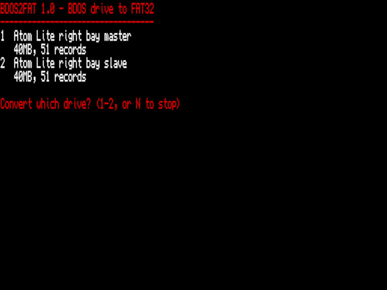
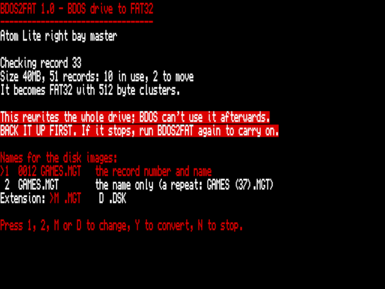
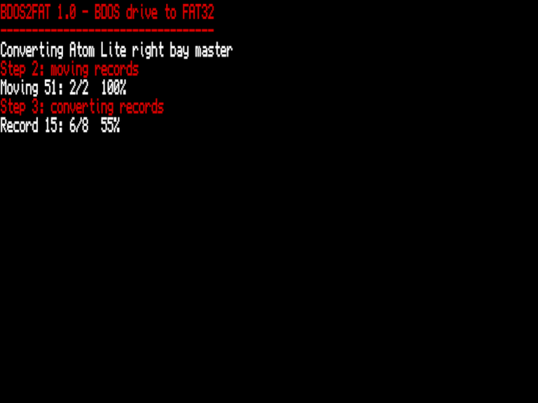
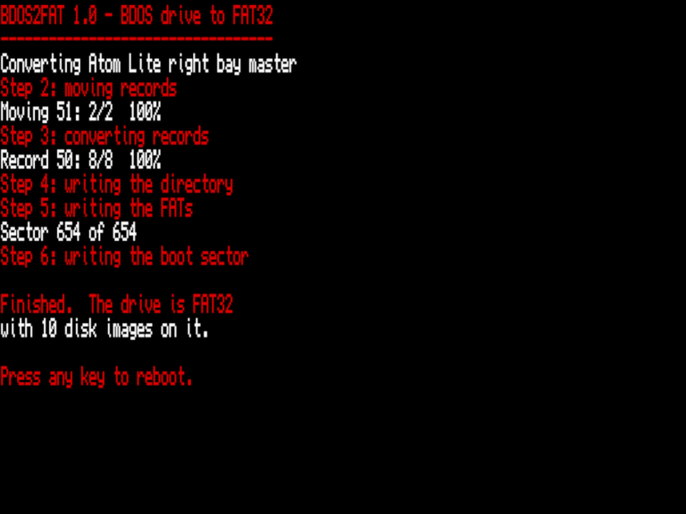

# ADOS utilities

The ADOS disk comes with some utility programs. Each is a separate program, not part of ADOS, and runs from BASIC under any DOS.

| Utility | What it does |
| ------- | ------------ |
| [BDOS2FAT](#bdos2fat) | Turns a BDOS drive into a FAT32 drive, with every record in use as an 800K disk image file |
| [MAKEBOOT](#makeboot) | Makes an Atom Lite card boot ADOS by itself at power on, with no floppy disk |

## BDOS2FAT

BDOS2FAT turns a BDOS drive into a FAT32 drive, on the SAM itself. Every record in use becomes an 800K disk image file in the root folder. ADOS, SimCoupe and a PC can all use the result. The drive can be an Atom Classic or Atom Lite hard drive or card, or a Trinity SD card.

### What you get

- **A FAT32 drive** with an MBR and one partition covering the whole drive.
- **One disk image file for each record in use**, with the name style and extension you choose (see [Names](#names)).
- **Standard images**: each file is a raw 800K SAM disk (MGT order, sides interleaved), the same as an `.MGT` file. ADOS opens it with `DIR = "C:\0012 GAMES.MGT"` or `OPEN "B:" TO ...` (see [Disk Images](Disk%20Images.md)).

A record counts as in use if its directory holds at least one file (anywhere in it, even if the first files were erased). A name on its own doesn't count: BDOS names every record it formats, so a card can have thousands of named records that are empty (for example `blank302`, `blank303`, ...). Records with no files are left out, and their space becomes free space on the FAT32 drive.

### Names

There are two styles of name, chosen before the conversion starts:

| Choice | Examples | Repeated names |
| ------ | -------- | -------------- |
| **1** Number and name | `0012 GAMES.MGT`, `0007.MGT` for a record with no name | The number makes every name different, and the files list in record order |
| **2** Name only | `GAMES.MGT`, `Record 7.MGT` for a record with no name | A name already used by an earlier record gets the record's number added: `GAMES (37).MGT` |

The extension is **M** `.MGT` or **D** `.DSK`. Both are the same raw image. `.MGT` is the safer choice for PC tools, as `.DSK` is also used for Amstrad and Spectrum +3 disk images, which are a different format.

In both styles, the characters `" * / : < > ? \ |` become `_`, spaces at either end are removed, the protect bit BDOS keeps in a name is ignored, and the SAM's £ and © stay as £ and ©. Names are compared without regard to case, as Windows does.

### Before you start

**Back up the drive.** BDOS2FAT rewrites the whole drive, and BDOS can't use it afterwards. On a PC, take an image of the card or drive first, for example with Win32 Disk Imager.

The drive needs a few **free records**. The FAT goes at the start of the drive, so the records there are moved into records that aren't in use. Usually it is only one or two. BDOS2FAT tells you if there aren't enough, before it changes anything.

The drive must be at least **33MB**, the smallest a FAT32 drive can be.

### Running it

BDOS2FAT is on the ADOS disk. Load it from BASIC, and it starts as soon as it has loaded:

```text
CLEAR 32767: LOAD "BDOS2FAT" CODE
```

It changes to screen mode 3 and lists the BDOS drives it finds. Press a drive's number, or **N** to stop. It looks at the drive (only reading) and shows:

- the drive's size and records,
- how many records are in use, and how many must move,
- the FAT32 cluster size,
- the choices for the names.

Press **1** or **2** for the names and **M** or **D** for the extension, then **Y** to convert the drive (and **Y** again when asked if you are sure), or **N** to leave it unchanged.





The conversion has six steps, and it shows its progress through them:

| Step | What it does |
| ---- | ------------ |
| 1 | Looks at the drive and asks before going on. This step only reads: nothing is written until you have answered **Y** twice |
| 2 | Copies the records in the way of the FAT (and a partial last record) into free records |
| 3 | Converts each record in use where it is |
| 4 | Writes the root folder, using the BDOS record names |
| 5 | Writes the two FATs |
| 6 | Writes the boot sector, then the MBR (this makes it a FAT32 drive) |

Step 3 takes most of the time. Each record is read and written once, so allow roughly 15–40 seconds a record.

While it moves and converts records, it shows a progress line such as `Record 12: 3/9  45%`. That means record 12, the 3rd of the 9 records it has to convert, and 45% of the way through it. Step 5 shows the FAT sectors written.





When it says **Finished**, it asks you to press any key, and then reboots the SAM. It doesn't go back to BASIC, because the DOS that is loaded still thinks the drive is a BDOS drive. It stops the same way after a disk error.

### If it stops

A power cut, a reset or a disk error part way through doesn't lose anything. BDOS2FAT keeps a note in the drive's first sector of how far it has got. Run BDOS2FAT again: it shows the drive as **Conversion not finished**, and carries on from where it stopped.

Until it has finished, neither BDOS nor ADOS can use the drive properly. Don't write to it with anything else.

### What it does to the drive

A BDOS record already holds exactly the sectors of a disk image, just in a different order: BDOS keeps side 1's tracks, then side 2's, while an image interleaves the sides. BDOS2FAT lays the FAT32 drive out so that each record's sectors become its file. So the records stay where they are and only their tracks are put in order, apart from the few moved out of the way of the FAT.

On an Atom Classic, BDOS stored the bytes of each sector in a different order from a PC, so BDOS2FAT also puts them in PC order as it goes.

The clusters are as big as FAT32 allows on the drive, up to 32K. This keeps the FAT small, so fewer records need moving and ADOS finds free space faster. Each image is exactly 25 clusters of 32K, so no space is wasted.

## MAKEBOOT

MAKEBOOT makes an Atom Lite card boot ADOS by itself when the SAM is switched on or reset, with no floppy disk and no Liaise. It needs the Atom Lite boot ROM (Edwin Blink's AL BOOT ROM, from [World of SAM](https://www.worldofsam.org/products/atom-lite-boot-rom)), which boots from a card whose sector 0 holds a boot loader. MAKEBOOT puts ADOS's loader there and ADOS itself in sectors that belong to no file system.

### What it changes

- **Sector 0**: the loader goes into the bytes the layout leaves free. An MBR's partition table, or a FAT boot sector's BPB, stays as it is, so a PC still sees the card as it was.
- **38 sectors of ADOS**, in the first run of free sectors it finds: the gap before the first partition (from sector 1), or the reserved sectors of a FAT volume, after the copies of the FAT32 boot sector and FSInfo. On a BDOS card they go in a record that has never been formatted (see below), and the card's own boot sector is saved after them.
- **Nothing else.** No file, FAT or directory is touched, and no formatted BDOS record. If the card has no room, MAKEBOOT says so before it writes anything.

### Which cards

- **A card used on a PC** (MBR, FAT16 or FAT32): works if there is a gap before the first partition. PC tools usually leave 2048 sectors.
- **A card converted by BDOS2FAT**: works with the BDOS2FAT on this release's disk, which keeps 64 or more reserved sectors, enough for ADOS. A card converted by an earlier one may keep only 32, which is too few, so MAKEBOOT refuses it.
- **A FAT32 card with no partition table**: usually refused: its reserved sectors are too few.
- **An AL-BDOS card** (or a renamed one): works if one of its records has never been formatted. A BDOS card has no sectors outside its records, so MAKEBOOT puts ADOS in the highest record that has never been formatted, and saves the card's own boot sector after it. It shows the sector it will use and asks first. Formatting that record in BDOS would remove ADOS. If every record is formatted it refuses and changes nothing. A BDOS card with no boot sector at all (plain BDOS) is refused: the ROM can't boot it.

It writes the ADOS sectors first and checks them, then writes sector 0 last. A card is never left with a boot sector that has nothing to load.

### Running it

MAKEBOOT is on the ADOS disk. Load it from BASIC, and it starts as soon as it has loaded:

```text
CLEAR 32767: LOAD "MAKEBOOT" CODE
```

It lists the Atom Lite drives that have a card. Press a drive's number, or **N** to stop. It reads the card (only reading), shows which sectors ADOS will go in, and asks. Press **Y** to write it, or **N** to leave the card unchanged. If sector 0 already has boot code, it says so: writing replaces it.

### Booting from the card

Fit the AL BOOT ROM and switch on or reset. The ROM reads the card's boot sector, which loads ADOS and starts it, and the SAM goes to BASIC. ADOS has found its drives, so DIR, LOAD and the rest work. At this point in the ROM's start up the screen can't be set up, so ADOS shows no report as it does when booted from a floppy.

- **Drives.** The default drive is the floppy (A:), as after a floppy boot. Type the card's drive letter to use the card, for example `C:`.
- **F9** doesn't restart the SAM. It loads the `AUTO*` file from the current drive, and reports "No Disk" if that is the floppy and it is empty. To boot the card again, reset.
- **Floppy or another card.** Hold **SPACE** at reset to boot from a floppy instead, or a key from **1** to **4** to pick a card, as the ROM does for any DOS.
- **BDOS cards.** Hold **B** while resetting to boot BDOS instead of ADOS: the card's own boot sector, saved by MAKEBOOT, runs as the ROM would have run it. With no key held, ADOS loads. (SPACE can't be used for this: the ROM takes it for the floppy before the card is read.)
- **BDOS menu programs**, such as the record selector in a card's first record, don't work under ADOS: they use BDOS's private memory, and the list shows rubbish. Use them under BDOS (hold **B**). If you have run one under ADOS, reset the SAM, as it may have changed ADOS's memory.
- **SimCoupe.** To test, use Options, ROM, "Use Atom / Atom Lite boot ROM if connected" with Drive 2 set to Atom Lite.

### Notes

- To update ADOS on the card, run MAKEBOOT again: it finds its own sectors again and replaces them. On a BDOS card it finds the saved boot sector by the marker in sector 0, so the saved copy stays the real BDOS one.
- The card must not be written to by anything else while MAKEBOOT runs. Take a copy first if it holds anything you can't replace.
